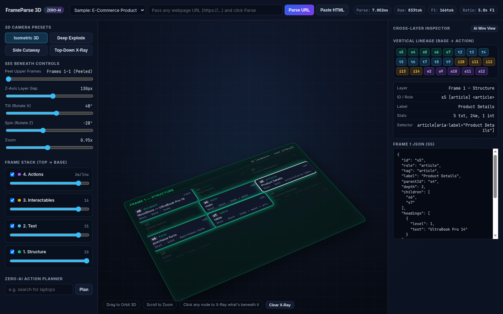
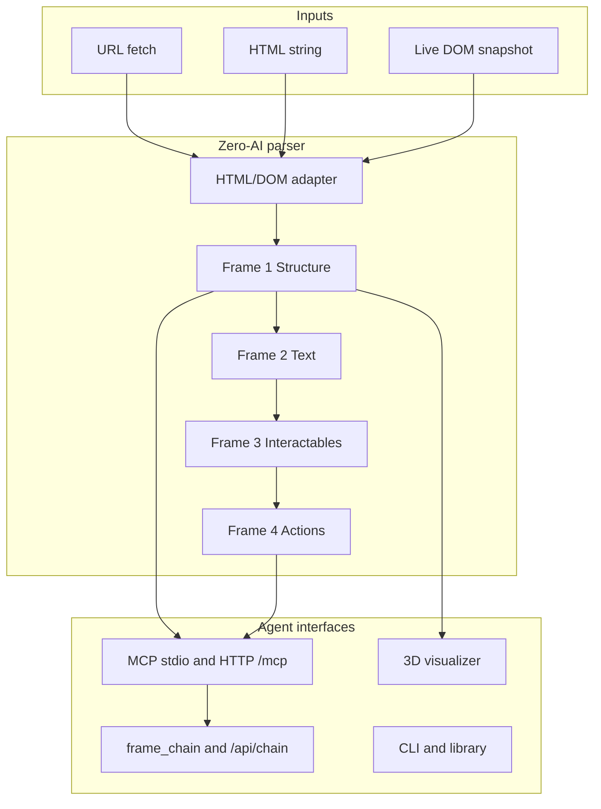

# FrameParse

**Progressive, zero-LLM webpage observations for AI agents — Structure → Text → Interactables → Actions.**

Most browser agents still dump megabytes of HTML into context. FrameParse parses a page once (milliseconds, **no model calls**), returns a compact landmark map first, then lets agents pull only the layers they need via MCP, HTTP, CLI, or the TypeScript library.

```bash
git clone https://github.com/RajKavadia/frameparse.git && cd frameparse
npm install && npm run build && npm test
node dist/src/cli.js tests/fixtures/ecommerce.html --layer 1 --stats
npm run visualizer   # http://127.0.0.1:4173 — 3D stack + MCP at /mcp
```

| Goal | Start here |
|------|------------|
| Cursor / Claude MCP | [`mcp.json.example`](mcp.json.example) → `node dist/src/cli.js mcp` |
| Smallest first read | `frame_open` → Frame 1 only (~90–250 tok on fixtures) |
| Find a fact on the page | `frame_query` or region-scoped `frame_read` |
| Plan a click/fill flow | `frame_plan` → workflows `w#` + steps (use **your** browser runner) |
| After a mutation | `frame_diff` — delta, not full re-parse |
| Multi-step in one call | `frame_chain` or `POST /api/chain` |

**Benchmarks (reproducible):** run `npm run benchmark` — see [docs/BENCHMARKS.md](docs/BENCHMARKS.md). On a synthetic 251 KB SPA fixture: Frame 1 **196 tok** vs **64,257 tok** raw (~**328×** on the structure layer); MCP “open + query” **447 tok** vs **64,257** raw in the harness.



## What it is (and is not)

**FrameParse is an observation and planning layer:** deterministic HTML/DOM → cross-linked frames + MCP session cache + zero-AI `planAction`.

**It is not** a built-in browser driver. Frame 4 `steps` include CSS selectors for Playwright, Puppeteer, CDP, or similar. For live SPAs, use the MCP resource `frameparse://browser-extractor.js`, capture a post-hydration snapshot, and pass it to `frame_open`.

## Four frames

1. **Frame 1 — Structure (`s#`)** — Landmarks, heading outline, repeated-card folding, region counts.
2. **Frame 2 — Text (`t#`)** — Readable blocks anchored to `@s#`; strips script/style/hidden noise.
3. **Frame 3 — Interactables (`i#`)** — Controls with names, states, options, selectors.
4. **Frame 4 — Actions (`w#`, `a#`)** — Workflows, effect tiers (`read` | `navigate` | `mutate` | `destructive`), planner, diff.

## Architecture



## CLI

```bash
node dist/src/cli.js tests/fixtures/ecommerce.html --layer 2 --region s4
node dist/src/cli.js tests/fixtures/ecommerce.html --plan "add to cart"
node dist/src/cli.js tests/fixtures/dashboard.html --diff tests/fixtures/dashboard-after.html
node dist/src/cli.js chain --preset orient_and_plan --fixture ecommerce --goal "add to cart"
npm run visualizer
```

## 3D visualizer

Open `http://127.0.0.1:4173` after `npm run visualizer`: orbit stacked layers, peel upper frames, X-ray lineage from any card, try the built-in zero-AI planner on sample pages.

## Library

```ts
import { FrameSession, parsePageFrames, executeToolChain } from "frameparse";

const session = new FrameSession(html, { url: "https://example.com" });
const frame1 = session.getStructure();
const matches = session.plan("add to cart", { allowDestructive: false });
```

## MCP server (8 tools)

| Tool | Purpose |
|------|---------|
| `frame_open` | Parse once; return Frame 1 + `sessionId` |
| `frame_query` | Cross-layer keyword search |
| `frame_read` | Budgeted layer read (`maxTokens`, pagination) |
| `frame_plan` | Goal → ranked actions/workflows |
| `frame_inspect` | Lineage for any `s#`/`t#`/`i#`/`w#`/`a#` |
| `frame_diff` | Post-action delta; optional outcome cache |
| `frame_sessions` | List/close sessions + telemetry |
| `frame_chain` | Multi-step chain or presets |

**Chains:** MCP `frame_chain`, HTTP `POST /api/chain`, CLI `chain`. Presets: `orient_and_plan`, `query_then_inspect`, `plan_and_inspect`, `action_and_observe`. Variables: `$sessionId`, `$prev.ref`, `$steps.<alias>.actionId`.

```json
{
  "mcpServers": {
    "frameparse": {
      "command": "node",
      "args": ["/absolute/path/to/frameparse/dist/src/cli.js", "mcp"]
    }
  }
}
```

Streamable HTTP: `POST http://127.0.0.1:4173/mcp` while the visualizer is running.

Agent skill: [`skills/frameparse/SKILL.md`](skills/frameparse/SKILL.md).

## FAQ

**Does FrameParse click buttons?** No — it returns selectors and steps; you execute them elsewhere.

**Are token counts exact for GPT/Claude?** No — `estimateTokens` is a fast heuristic; use benchmarks for relative savings.

**Can it log into sites via MCP URL fetch?** Not with cookies/auth; use a live DOM snapshot from a browser you control.

**Is there an npm package?** Install from git for now (`v0.2.0` tag); npm publish is planned.

## Limitations

Heuristic action inference (confirm `destructive` with users). Server-side `frame_open` URL fetch should run in trusted environments (SSRF). Early OSS — contributions welcome; see [CONTRIBUTING.md](CONTRIBUTING.md).

## License

MIT — see [LICENSE](LICENSE).