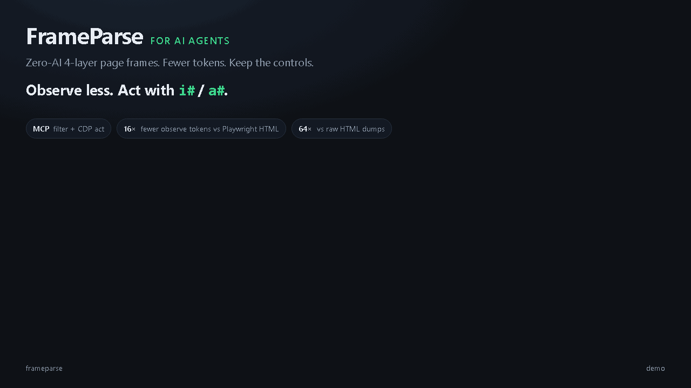

# FrameParse

**Zero-AI, deterministic 4-layer webpage frame parser + CDP actuator for fast AI agent browsing.**

FrameParse decomposes any HTML / live browser DOM into **4 progressive, cross-referenced frames** in a few milliseconds with **zero LLM calls**:

1. **Frame 1 — Structure (`s#`)**: Semantic landmarks (`header`, `nav`, `main`, `article`, `form`, `table`, `footer`), heading outline, per-region text/interactable counts, and structural hash.
2. **Frame 2 — Text (`t#`)**: Clean, deduplicated readable content (`heading`, `paragraph`, `list_item`, `table_row`, `alert`) anchored to its parent Frame 1 region (`@s#`), with `<script>`, `<style>`, and hidden DOM noise stripped.
3. **Frame 3 — Interactables (`i#`)**: Canonical registry of interactive controls (`link`, `button`, `input`, `select`, `checkbox`, `form`, `tab`, etc.) with resolved accessible names, states, options, form links, and deterministic CSS selectors.
4. **Frame 4 — Actions (`w#`, `a#`)**: Deterministic specification of **what each control or multi-step form workflow will do**, including verb, intent category, side-effect safety tier (`read` | `navigate` | `mutate` | `destructive`), preconditions, parameters, and executable steps — plus a **zero-AI action planner** (`planAction`) and **frame differ** (`diffFrames`).

Core parse stays **zero runtime dependencies**. Optional CDP actuation uses Node’s built-in `WebSocket` + Chrome remote debugging (no Puppeteer required at runtime).



**Benchmarks (local fixtures):** FrameParse MCP ≈ **64.5×** fewer output tokens vs raw HTML; ≈ **16.1×** fewer observe tokens vs Playwright HTML — same fill/click success.

## Install

```bash
npm install frameparse
```

### Cursor plugin

This repo is a [Cursor Plugin](https://cursor.com/docs/plugins): MCP server + agent skills.

- Manifest: `.cursor-plugin/plugin.json`
- MCP: `mcp.json` (`npx -y frameparse mcp`)
- Skills: `skills/frameparse`, `skills/cdp-frameparse-filter`

Submit / install from the public GitHub repo via [Cursor Marketplace publish](https://cursor.com/marketplace/publish), or link the repo as a local plugin for testing.

```bash
# from source
npm install
npm run build
npm test
```

## CLI Usage

```bash
# 1. Inspect Frame 1 (Structure) first
node dist/src/cli.js tests/fixtures/ecommerce.html --layer 1 --stats

# 2. Pull Frame 2 (Text) only for a specific landmark region (e.g. s4)
node dist/src/cli.js tests/fixtures/ecommerce.html --layer 2 --region s4

# 3. Inspect Frame 3 (Interactables) or Frame 4 (Actions)
node dist/src/cli.js tests/fixtures/ecommerce.html --layer 4 --url https://novastore.example.com

# 4. Run the zero-AI action planner for a goal
node dist/src/cli.js tests/fixtures/ecommerce.html --plan "search for laptops"

# 5. Diff two page states after executing an action
node dist/src/cli.js tests/fixtures/dashboard.html --diff tests/fixtures/dashboard-after.html

# 6. Launch the interactive 3D Layered Frame Visualizer
npm run visualizer
# or: node dist/src/cli.js serve --port 4173
```

## 3D Layered Frame Visualizer

Run `npm run visualizer` and open `http://127.0.0.1:4173` to inspect all 4 frames stacked in 3D space:

- **Pass any webpage**: Enter any live URL, paste raw HTML, or pick a built-in sample.
- **See what's beneath each frame**: Drag to orbit in 3D, expand the **Z-Axis Layer Gap**, drag the **Peel Upper Frames** slider to lift Frame 4/3/2 off the stack, or adjust per-layer opacity.
- **Cross-layer X-Ray**: Hover or click any card on any frame (e.g., a Frame 4 workflow `w1`) to illuminate its exact vertical lineage down through Frame 3 → 2 → 1.
- **Zero-AI Planner**: Enter a goal like `"search for laptops"` or `"add to cart"` to highlight the winning workflow and everything beneath it.

## Library Usage

```ts
import { FrameSession, parsePageFrames, planAction, diffFrames } from "frameparse";

const session = new FrameSession(html, { url: "https://novastore.example.com" });
const frame1 = session.getStructure();
const mainRegion = frame1.landmarks.find((l) => l.role === "main");
const frame2 = session.getText(mainRegion ? [mainRegion.id] : undefined);
const matches = session.plan("add to cart", { allowDestructive: false });
```

Live browser DOM (SPAs / Shadow DOM / visibility):

```ts
import { LIVE_DOM_EXTRACTOR_SCRIPT, parseLiveSnapshotFrames } from "frameparse";
// Run LIVE_DOM_EXTRACTOR_SCRIPT in the page (CDP / Playwright evaluate), then:
const parsed = parseLiveSnapshotFrames(snapshot, { url: snapshot.url, maxLayer: 4 });
```

## Agentic-First MCP Server (Less Tokens, More Info)

FrameParse ships an MCP server (stdio + Streamable HTTP `POST /mcp`) with **progressive read tools** and a **built-in CDP actuator** so agents can observe *and* click/scroll using frame refs (`i#` / `a#` / `w#`) — not DevTools a11y `uid`s.

| MCP Tool | Purpose | Typical Cost |
|---|---|---|
| `frame_open` | Parse URL/HTML/live `snapshot` / fixture; return **Frame 1** only | ~120–250 tok |
| `frame_query` | Zero-AI cross-layer search | ~80–180 tok |
| `frame_read` | Region-scoped layer reader + `maxTokens` | Budgeted |
| `frame_plan` | Zero-AI goal → workflows / actions | ~120–250 tok |
| `frame_inspect` | Vertical lineage for any `s#`/`t#`/`i#`/`w#`/`a#` | ~100–200 tok |
| `frame_diff` | Post-action delta only | ~40–150 tok |
| `frame_sessions` | Session list / close + token savings | ~80 tok |
| `frame_browser` | CDP `status` / `connect` / `launch` / `navigate` / `open` (live snapshot → session) | — |
| `frame_act` | Execute click/fill/select/toggle/submit/navigate/hover/focus/type/press via `i#`/`a#`/`w#` or `goal` | + `frame_diff` |
| `frame_scroll` | `into_view` / `by` / `to` using frame refs | + `frame_diff` |

### CDP browse + act loop

```text
1. Start Chrome with --remote-debugging-port=9333 --remote-allow-origins=*
2. frame_browser({ action: "connect", browserURL: "http://127.0.0.1:9333" })
3. frame_browser({ action: "open", url: "https://example.com/", sessionId: "p1" })
4. frame_query / frame_plan as needed
5. frame_act({ sessionId: "p1", ref: "i1" })   // or goal: "add to cart"
6. Use returned frame_diff (default reobserve)
```

Destructive Frame 4 actions require `confirmDestructive: true` after explicit user confirmation.

### Connect to Cursor / Claude Desktop

See `mcp.json.example`:

```json
{
  "mcpServers": {
    "frameparse": {
      "command": "node",
      "args": ["C:/path/to/frameparse/dist/src/cli.js", "mcp"]
    }
  }
}
```

Or Streamable HTTP while running `npm run visualizer` at `http://127.0.0.1:4173/mcp`.

## Benchmarks

```bash
# Parser latency + MCP token efficiency
npm run benchmark

# Scrape baselines (raw HTML / Cheerio / jsdom / Readability) vs FrameParse
npm run benchmark:compare

# Browser automation frameworks (Playwright / Puppeteer HTML+a11y) vs FrameParse
npm run benchmark:automation
```

Lower **observe / output tokens** is better for AI agents (less context burned). Acts measure whether fill/click still succeeds.

### 1) Scrape baselines vs FrameParse (`npm run benchmark:compare`)

Same fixtures/tasks: find price, locate Add to Cart, large SPA find #142, dashboard post-login diff.

#### Totals

| Framework | Tasks | Answer hits | Output tokens | vs raw | Latency |
|---|---:|---|---:|---|---:|
| raw-html | 4 | 4/4 | 66,136 | 1.0× | ~0 ms |
| cheerio-text | 4 | 4/4 | 8,556 | 7.7× | ~47 ms |
| jsdom-text | 4 | 4/4 | 8,556 | 7.7× | ~209 ms |
| readability | 4 | 3/4 | 7,728 | 8.6× | ~208 ms |
| **frameparse-mcp** | 4 | **4/4** | **1,026** | **64.5×** | ~38 ms |

#### Per-task output tokens

| Task | raw-html | cheerio | jsdom | readability | frameparse |
|---|---:|---:|---:|---:|---:|
| E-Commerce: find price $1,499 | 856 | 167 | 167 | 66 | **300** |
| E-Commerce: locate Add to Cart | 856 | 167 | 167 | 66 (miss) | **228** |
| Large SPA (~200 cards): find #142 | 64,228 | 8,170 | 8,170 | 7,556 | **429** |
| SaaS Dashboard: post-login change | 196 | 52 | 52 | 40 | **69** (delta) |

Notes: Readability missed “Add to Cart” (drops form controls). FrameParse keeps controls/workflows and uses `frame_diff` for post-action observation.

### 2) Automation frameworks vs FrameParse (`npm run benchmark:automation`)

Same local pages + agent tasks. Observe = tokens dumped to the model; Act = fill/click success.

#### Totals

| Framework | Tasks | Answer hits | Acts | Observe tokens | vs Playwright HTML | Avg observe ms |
|---|---:|---|---|---:|---|---:|
| playwright-html | 5 | 5/5 | 3/3 | 20,477 | 1.0× | 66 |
| puppeteer-html | 5 | 5/5 | 3/3 | 20,477 | 1.0× | 37 |
| playwright-a11y | 5 | 5/5 | 3/3 | 8,140 | 2.5× | 73 |
| puppeteer-a11y | 5 | 5/5 | 3/3 | 23,959 | 0.9× | 48 |
| **frameparse-frames** | 5 | **5/5** | **3/3** | **1,269** | **16.1×** | **20** |

#### Per-task observe tokens

| Task | PW HTML | PW a11y | PP HTML | PP a11y | FrameParse |
|---|---:|---:|---:|---:|---:|
| Ecom: observe price $1,499 | 835 | 375 | 835 | 998 | **182** |
| Ecom: fill search + click Search | 835 | 375 | 835 | 998 | **293** |
| Ecom: click Add to Cart | 835 | 375 | 835 | 998 | **341** |
| Dashboard: find Sign In | 305 | 169 | 305 | 471 | **234** |
| Large SPA: find Workstation #77 | 17,667 | 6,846 | 17,667 | 20,494 | **219** |

Takeaway: Playwright/Puppeteer match FrameParse on **act success**; FrameParse wins on **agent observation cost** (especially large pages). Use automation frameworks (or FrameParse CDP) as hands; use FrameParse frames as eyes.

## Agent Skills

| Skill | Path |
|---|---|
| Core MCP browse loop | `skills/frameparse/SKILL.md` |
| CDP filter + actuation | `skills/cdp-frameparse-filter/SKILL.md` |

Copy into your agent skills directory (e.g. Cursor user Agent Store) as needed.
