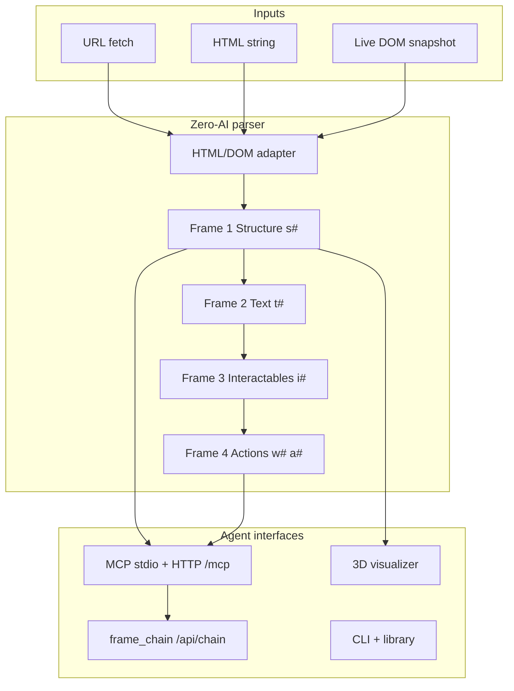

# FrameParse

**Progressive, zero-LLM webpage observations for AI agents — Structure → Text → Interactables → Actions.**

Most browser agents still dump megabytes of HTML into context. FrameParse parses a page once (milliseconds, **no model calls**), returns a **~150-token map** of landmarks, then lets agents pull only the layers they need via MCP, HTTP, or library APIs.

```bash
git clone https://github.com/RajKavadia/frameparse.git && cd frameparse
npm install && npm run build && npm test
node dist/src/cli.js tests/fixtures/ecommerce.html --layer 1 --stats
npm run visualizer   # http://127.0.0.1:4173 — 3D stack + MCP at /mcp
```

| You want… | Start here |
|-----------|------------|
| Cursor / Claude MCP | Add [`mcp.json.example`](mcp.json.example) → `node dist/src/cli.js mcp` |
| Smallest first read | `frame_open` → Frame 1 only (~90–250 tok on fixtures) |
| Find “price / login / cart” | `frame_query` or region-scoped `frame_read` |
| Executable plan | `frame_plan` → workflows `w#` + steps (wire to **your** Playwright/CDP) |
| After a click | `frame_diff` — delta, not full re-parse |

**Verified on this repo (run `npm run benchmark`):** synthetic 251 KB SPA → Frame 1 **196 tok** vs **64,257 tok** raw (~**328×** on structure layer); MCP workflow “open + query” on that page **447 tok** emitted vs **64,257** raw (~**99.3%** fewer tokens in benchmark harness).

[Architecture](#architecture) · [MCP tools](#mcp) · [Limitations](#limitations) · [License](#license)

## What it is (and is not)

**FrameParse is an observation & planning layer:** deterministic HTML/DOM → compact frames + MCP session cache + zero-AI `planAction`.

**It is not** a built-in browser driver. Frame 4 `steps` include CSS selectors for **your** automation stack (Playwright, Puppeteer, CDP, etc.). Live SPAs: inject `frameparse://browser-extractor.js` (MCP resource) and pass the JSON snapshot to `frame_open`.

## Architecture



Refs (`s4`, `t12`, `i3`, `w2`) cross-link across layers; `frame_inspect` walks the full vertical lineage.

## MCP

Eight tools on a shared `SessionStore`: `frame_open`, `frame_read`, `frame_query`, `frame_plan`, `frame_inspect`, `frame_diff`, `frame_sessions`, `frame_chain`.

See [README on branch `cursor/direct-tool-chain-783c`](https://github.com/RajKavadia/frameparse/tree/cursor/direct-tool-chain-783c) for `frame_chain` presets, or merge that branch before launch.

## Limitations

- Heuristic action inference (not a substitute for human QA on destructive flows).
- `frame_open` URL fetch is server-side `fetch` — no built-in auth/cookie jar.
- Token counts use `estimateTokens` (length-based), not a specific model tokenizer.
- Early project: **0** GitHub stars, no published npm package yet (install from git).

## License

MIT (per `package.json` and GitHub license detection). **Recommended:** add a root `LICENSE` file before launch.